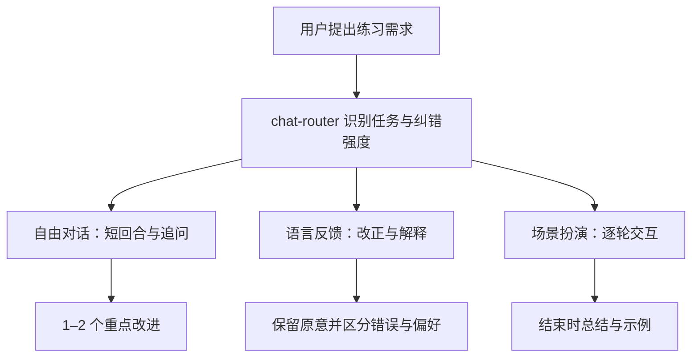

# Codex / ChatGPT 在线插件与公开英语学习 Skills 调查

调查日期：2026-10-14，北京时间。调查目标：确认目前可找到哪些英语或语言学习插件 / Skills，说明具体功能、交互流程、文件与数据结构，并判断哪些做法值得参考。

## 1. 调查结论

**有相关插件，而且不止一个。** 本次在当前账号可见的 ChatGPT 在线公开目录中核对了 16 个相关插件详情，其中有纯 Skills 插件、连接外部服务的应用，以及应用和 Skill 组合的插件。`English Speaking Coach` 还在本会话的 Codex 可用 Skills 中出现，其本地安装包可读取。[在线插件目录](https://chatgpt.com/plugins)、[English Speaking Coach](https://chatgpt.com/plugins/plugins_6ab38506b37081919440b03fb94418f2)。

**公开 GitHub 上已经有完整的语言学习 Skill 项目。** 除了把 AI 设成英语老师的单文件指令，还能找到多 Skill 课程、个人错误档案、间隔复习算法、雅思素材管理、歌曲学习、音频转录与本地播放器。第 5 节按源码拆解代表性项目。

**本次样本不足以给出“市场上最流行的英语 Skill”排名。** 能核实的是仓库关注数、目录显示的安装计数，以及功能在不同项目中重复出现；这些都不能直接证明实际学习人数、留存或教学效果。第 4 节说明检索入口，第 5 节保留关注度快照。

如果为了研究英语学习插件如何设计，建议先读 **English Speaking Coach → Fluent → IELTS SpeakingSkill → Language Learning Vault / Lingua Mate**：依次理解轻量教学路由、跨会话学习状态、按任务拆分工作流，以及音频材料处理。这个阅读顺序是本报告的判断，不是官方推荐或学习效果排名。

## 2. 范围、方法与证据标准

### 2.1 名称和边界

这里将用户所说的“Codex GPT 在线插件”按 **Codex / ChatGPT 当前插件和 Skills 生态** 调查。没有把旧版 ChatGPT Plugins、普通自定义 GPT、完整独立 App 和 Agent Skill 混为一类。

本报告使用以下分析分类；它们用于解释架构，不代表平台的完整官方分类规则：

| 类型 | 本次能观察的结构 | 典型样本 |
|---|---|---|
| 教学指令型 Skill | `SKILL.md` 规定角色、步骤、纠错方式和输出；未必有脚本或数据库 | English Speaking Coach、English Coach |
| 多 Skill 学习系统 | 多入口 Skill + 学习数据 + 持久化 / 复习机制 | Fluent |
| 单入口、多工作流 Skill | 主文件路由，按需读取 references 与数据合同 | IELTS SpeakingSkill |
| 外部应用型插件 | 在线目录显示“应用”；连接题库、账户、词汇库或课程平台 | English Exercises、WordByWord、italki |
| 应用 + Skill | 外部工具提供数据，Skill 规定教学交互 | Class Key |
| 材料处理与练习工具 | Skill 调用下载、转录、生成脚本或播放器 | Lingua Mate、Language Learning Vault |

### 2.2 检索与验证

1. 用插件发现接口查询 `English language learning speaking tutor`、`英语 学习 语言`、`English Speaking Coach`、`Duolingo Speak Babbel language tutor`。
2. 用已登录网页核查公开目录的 `English`、`language` 搜索结果，逐个读取 16 个相关详情页。
3. 阅读 English Speaking Coach 的本地 manifest 与全部 4 个 Skill 正文；展开 Grammar Checker 的 36 个 Skill 名称 / 描述，并读取 `academic-paper-check` 的在线正文。
4. GitHub 部分使用已连接 GitHub MCP 搜索仓库、搜索文件、读取内容；结合公开搜索、GitHub REST 元数据、目录树、实际 Skill 和辅助代码。引用尽量固定到 commit SHA。
5. 排除只是在 README 写了 English 的编程项目、普通翻译 / 本地化工具、重复镜像，以及没有核对源码的聚合页面。

插件发现接口这一轮主要返回连接应用，漏掉了网页可见的 English Speaking Coach 等 Skills 插件。因此，**接口未返回某个工具，不等于目录没有该工具**。网页结果也会随账号、权限、地区和目录更新变化；本报告是本次可见样本，不是全目录普查。

### 2.3 怎么读报告中的结论

| 证据级别 | 能支持什么 | 不能支持什么 |
|---|---|---|
| **源码已核对** | 文件、流程、字段、算法或调用存在 | 本次没有运行，不能证明能成功安装、稳定运行或教得有效 |
| **在线说明已核对** | 目录当前列出的功能、Skill 数、版本、服务边界 | 不能推断未公开的工具 schema、服务器代码或全部 App 功能已接入插件 |
| **分析判断** | 对结构、复用方式和功能缺口的判断 | 不是作者承诺或平台认证 |
| **未验证** | 明确指出缺少的证据 | 不补写猜测为事实 |

没有开展真实学习者测试、发音盲测、CEFR / 雅思评分有效性验证、付费套餐评估或所有宿主兼容性验证。调查中误点 Learn Language 的试用入口触发一次自动安装，已撤销并确认恢复为未安装；这次操作没有作为教学功能测试证据。

## 3. 在线目录：具体有哪些，怎么做

下面 16 个项目均已读取在线详情。版本是页面当时显示值；App 的功能流程主要来自开发者说明。只有特别标注的项目进一步核对了 Skill 正文 / 本地源文件。

### 3.1 Skills 插件

| 插件、开发者、版本 | 结构 | 功能与交互 | 持久化 / 依赖 / 验证边界 |
|---|---|---|---|
| [English Speaking Coach](https://chatgpt.com/plugins/plugins_6ab38506b37081919440b03fb94418f2) · The Doers Firm LTD · 0.1.0 | 4 Skills | 需求路由、自由对话、工作 / 旅行等场景扮演、语法 / 词汇 / 自然表达反馈 | 全部本地 Skill 正文已读；包中没有专用学习数据库、音频脚本或外部 App 配置 |
| [IELTS Writing Coach - English](https://chatgpt.com/plugins/plugins_6ab40d61edc48191a95d83130bac8b01) · AI EVERYDAY LIMITED · 1.0.0 | 1 Skill：`IELTS Writing Coach - English & Language` | 粘贴题目和答案，处理 essay、letter、academic writing 与语法修改；入口也包括写作规划和提分建议 | 读到目录说明和 Skill 描述；未取得完整教学正文、评分规则和数据结构；不要与 GitHub 同名项目视为同一作者 |
| [Learn Language](https://chatgpt.com/plugins/plugins_6ab3100f8e8c8191a982b79ce0f5e018) · AI EVERYDAY LIMITED · 0.1.1+bundle.293ce9a25476410665e5896fbb75ce69 | 1 Skill：`Learn Language` | 用有兴趣的话题对话，扩充词汇；示例包含西班牙语、法语和英语 | 说明提到使用宿主 App 的 voice feature；没有证据表明插件实现独立录音、识别或发音评分 |
| [English Query Refiner](https://chatgpt.com/plugins/plugins_6ab49bd136108191bca3c030d5e019c8) · Anfreville · 0.7.1+bundle.8b2fcdeb52e00e0a2556f8c0b4e1ad99 | 1 Skill | 修改英语问题，双语回答，再将相同回答呈现为交互 HTML；示例包含 say / tell、中文转自然英文提问、自然度检查 | 是“回答任务 + 英语反馈 + HTML 呈现”；未核实 HTML 模板和学习记录 |
| [SentLines](https://chatgpt.com/plugins/plugins_6aa51e0923b88191a50e0e794cc8bd0f) · Hammurabi Games · 0.1.0+codex.20260928113737 | 1 Skill：`sentlines` | 选择练习语言、A1–C2 与已知语言 → 自动给相应难度段落 → 逐句纠错并给对齐翻译；支持图片文字、混合语言和大致记住的说法 | 默认 B1，除非明确修改；处理输入文字不等于实现音频听力测评；完整 Skill 正文未读 |
| [Grammar Checker](https://chatgpt.com/plugins/plugins_6ab11939c75081918398108b45282fad) · Syed Fasih Haider Raza Rizvi · 1.0.2 | 36 Skills | 按错误类型、文档场景、解释 / 改写 / 评分需求拆模块，也含 ESL 教学、语法练习、多语言语法 | 已展开全部模块描述，读了 academic-paper-check 正文；正文要求每条回复附推广链接与佣金披露。未读全部 36 个正文，未验证学习档案持久化 |
| [Chat Español](https://chatgpt.com/plugins/plugins_6ab219faa0c481919ef3e8eda9abae2b) · The Doers Firm · 0.1.0 | 4 Skills：`chat-router`、`spanish-conversation`、`spanish-culture`、`spanish-learning` | 路由 → 翻译 / 表达优化、文化与地区语域、解释 / 例子 / 纠错 / 练习 | 是语言通用结构参照；本身面向西班牙语。只核对目录结构与描述 |

### 3.2 English Speaking Coach：4 个 Skill 如何分工

这是本次在线样本中能够完整核对教学源文件的项目。manifest 通过 `skills: "./skills/"` 指向 Skills；包内除界面资源和 manifest 外，教学内容为四个 `SKILL.md`。没有 references、练习脚本或专用学习数据文件。

```text
english-speaking-coach/
├── .codex-plugin/plugin.json
├── assets/ 与 .codex-plugin/assets/   界面图标
└── skills/
    ├── chat-router/SKILL.md
    ├── natural-conversation-practice/SKILL.md
    ├── language-feedback/SKILL.md
    └── roleplay-scenarios/SKILL.md
```

| Skill | 输入与决策 | 行为和输出 |
|---|---|---|
| `chat-router` | 判断是自由对话、场景、句子修改、词汇还是学习计划；仅在水平 / 上下文实质影响练习时问一个简短问题 | 路由至另外三个 Skill；必要时商定 light / balanced / detailed 纠错强度 |
| `natural-conversation-practice` | 用户主题或日常主题，依据实际表现调难度 | 回合短，开放追问，让学习者多说；默认每轮最多给 1–2 个有价值改进；自然替代说法 + 简短解释 |
| `language-feedback` | 用户写作或聊天中的句子 | 保留意图与声音，先改正版本再解释；区分错误与风格偏好，承认多种正确形式；词汇解释和短例句；有需要才给 IPA |
| `roleplay-scenarios` | 工作 / 旅行 / 学习 / 日常情境 | 设场景与角色 → 学习者逐轮回应 → 卡住时可给提示 → 结束总结优点和少量改进 |



**分析判断：** 这种结构的优点是模块职责清楚、依赖少、容易在会话中开始练习。它没有自建的“错误记录 → 到期复习 → 再次正确使用”的跨会话机制。路由提到 learning plan，但没有独立的计划 / 课程编排 Skill；不能据此把它描述成完整课程系统。

**源码明确限制：** 文本聊天不能测量口音、真实发音、听力或口语流利度；角色扮演不能预测真实场景结果或认证语言能力。它的语音相关能力属于文字发音指导，实际语音体验依赖宿主。[在线详情及 4 个模块](https://chatgpt.com/plugins/plugins_6ab38506b37081919440b03fb94418f2)。

### 3.3 Grammar Checker：36 个模块如何组织

以下分组是本报告按功能整理的，原目录未声明这些分类：

| 分组 | 实际 Skill 名称 |
|---|---|
| 入口与总检查（3） | grammar-help、grammar-checker、quick-fix |
| 错误规则（7） | articles-prepositions、confused-words、capitalization-titles、punctuation-fixer、sentence-structure、spelling-check、verb-tense-agreement |
| 文档场景（9） | academic-paper-check、business-document-check、creative-writing-proofread、email-checker、essay-proofreader、formal-academic-check、resume-cover-letter-check、social-post-check、web-copy-check |
| 教学与解释（4） | esl-english-coach、grammar-practice、grammar-rules、proofread-explain |
| 表达、变体与文档质量（10） | consistency-check、humanize-text、long-document-proofread、multilingual-grammar、readability-check、rewrite-polish、style-clarity、style-guide-check、tone-check、us-uk-english |
| 报告与工具推荐（3） | writing-score-report、recommended-tools、writehuman-guide |

读到的 `academic-paper-check` 正文要求依次检查学术语言、术语 / 标点 / 数字 / 单位一致性、用户提供的引用格式，再输出修正版、一致性问题清单和引用格式检查表；缺失来源细节应标待核查，不能编造。它同时用很长的公共指令要求每条回复都附 WriteHuman 推广链接与佣金披露。

**分析判断：** 可以参考它按“错误 / 文档 / 输出”划分入口的方式；36 个 Skill 不等于 36 套独立教学系统，描述中有较多功能重叠。每轮强制附推广信息会影响学习体验，也会占用指令篇幅。`esl-english-coach` 描述说跟踪常见错误，但本次没有核对跨会话存储实现。[完整目录与 Skill 详情入口](https://chatgpt.com/plugins/plugins_6ab11939c75081918398108b45282fad)。

### 3.4 应用型插件：题库、词汇、学习记录与课程

| 插件、版本 | 在线说明中的实际流程 | 结构与关键边界 |
|---|---|---|
| [Language Coach: English](https://chatgpt.com/plugins/plugin_asdk_app_69c523ee8a408191a783745e132400fe) · 2.0.0 | 打开应用 → placement test → A1–C1 等级与分项结果 → 保存到账户 | 1 App，未列独立 Skill；说明明确更多练习模式“即将到来”，不能按已实现功能统计 |
| [English Exercises](https://chatgpt.com/plugins/plugin_asdk_app_6ac0e91fbf4c8191b8ec88226f2f793d) · 0.2.1 | 按主题与 CEFR 找已有题目 → 填空 / 句型转换 / 点选纠错 → 即时判题、提示、解释 → 最终分数与错题回看 | 1 App；页面列 Find English exercises、Interactive English practice；结果只留在当前播放器，账户进度不保存；听写和音频练习在网站，不在插件 |
| [Suplla](https://chatgpt.com/plugins/plugin_asdk_app_6a693ba99aa88191b8ca2764e6ebb9cd) · 1.1.0 | 登录 → 看英语学习进度 → 浏览语法 / 词汇 → 个性化练习 → 报告学习数据问题 | 1 App；账户型学习服务。没有取得题目算法、进度 schema 或复习代码 |
| [WordByWord – Learn Languages](https://chatgpt.com/plugins/plugin_asdk_app_6a79b7fc48c881919850190697b92543) · 1.0.0 | 建词汇集合 → 加单词 / 短语、翻译与例句 → 标已学 → 根据尚未掌握词汇生成练习 | 1 App；说明支持 50+ 语言并跟踪集合进度。没有证据表明使用 SM-2 / FSRS 等日期调度 |
| [Flashcards Space](https://chatgpt.com/plugins/plugin_asdk_app_698b6e07fd108191a836f403efe16b7a) · 1.0.0 | 在 ChatGPT 生成语言卡片并分牌组 → 保存到账户 → 编辑卡片正反面 / 删除刚创建的卡片 → iOS App 间隔复习 | 1 App；插件主要负责制作和同步卡片，SRS 练习在移动端。没有核对复习算法 |
| [Blossom](https://chatgpt.com/plugins/plugin_asdk_app_6947ba7a05108191bfc8005e75e87d3a) · 1.0.0 | 产品以外语日记为输入，介绍纠错、母语混写翻译、词汇游戏、跟读、追问、水平记录、真人批改和社区 | 1 App；在线示例为查看某日的日记。长说明涵盖整个 Blossom 产品，不能证明以上所有能力都通过 ChatGPT 插件开放；“perfect grammar”“最大”等宣传未验证 |
| [italki language learning](https://chatgpt.com/plugins/plugin_asdk_app_6948af96247c81919904f9478c34334f) · 2.0.0 | 根据时间、水平、目标、预算找母语教师的一对一或小组课程；目录示例包括英语口语和法语水平测试 | 1 App，真人课程服务入口；不能按 AI 教练 Skill 统计，也未测试选课、下单和课程完成流程 |
| [Promova](https://chatgpt.com/plugins/plugin_asdk_app_6a0c85864e54819184e0e45f036bccb5) · 1.0.0 | 5 道自适应语法题 → 标示 CEFR A1–C2 与分项结果 → 对应级别示例课程 → 跳转 Promova 学习计划 | 1 App；当前插件入口是短测验与课程引导。仅 5 道语法题不能作为本报告认可其流利度测量有效性的证据 |

### 3.5 Class Key：应用工具与教学 Skill 配合

[Class Key](https://chatgpt.com/plugins/plugin_asdk_app_6ab6865a344481919ff4d2a9bb5d6e5d)，开发者久貴 南部，1.0.0，同时显示 **1 App + 1 Skill `lesson-player`**。

可验证的说明流程：学习者提供六字符课程码 → `get_lesson` 取固定 schema 的老师备课设置 → 确认标题与版本 → 使用场景、AI 角色、可选英语水平、反馈设置在 ChatGPT 中练习。说明称工具不接收学生身份、答案或聊天转录，只记录调用次数并限制请求；教师登录和伴随网站的应用内报告尚未开放。公开示例码为 `CKTEST`，本次没有调用该课程。

**分析判断：** 它把“课程配置”与“AI 教学行为”分开：服务器管理课程设置，Skill 组织逐轮练习。这个结构适合教师分享练习模板。没有读完整 `lesson-player` 正文、工具 schema 或服务器代码，不能补写课程字段的确切 JSON。

### 3.6 仅在搜索结果中发现的补充候选

`language` 列表还显示了 Mynawoo AI Language Tutor、Preply Language Tutor Finder、Polyglot Cards、Vocabloot Deck Kit、Unclass Lesson Builder、Parrot 等。它们属于后续候选；本次未逐个读取详情或源码，不纳入上面 16 个分析样本。[language 目录搜索](https://chatgpt.com/plugins?search=language)。

Plain English / Plain Language 偏表达简化，Accurate Translation 偏翻译，FreeTTS 偏文本转语音。kernelCAD、Bagel 等虽在 English 搜索出现，主功能并非语言教学，未作为英语学习样本。

## 4. GitHub 搜索 MCP、Skill 库与“常见”的含义

**有可用的 GitHub MCP。本次已实际使用当前连接的 GitHub 工具**，可以搜索仓库、搜索文件、读取源码。无需另外安装一个“英语 Skill 搜索插件”。

| 入口 | 适合做什么 | 限制 |
|---|---|---|
| GitHub MCP | 找作者仓库、定位 `SKILL.md`、核对 references / scripts 与元数据 | 搜索覆盖与连接权限有关；English 一词会有很多无关结果 |
| [skills.sh](https://skills.sh/) | 按 Skill 名称找可安装来源，观察页面显示的安装计数 | 目录计数不等于真实活跃学习者；同名 Skill 可能来自不同作者 |
| Awesome Agent Skills / Awesome OpenClaw Skills | 找候选名称与作者仓库 | 聚合清单主要是导航；不能把被收录当官方审核、兼容性或质量保证 |
| GitHub 仓库 README + 源码树 | 理解文件组织、宿主、依赖、许可和学习状态 | README 可能把计划、宣传和已有功能混写，需要再读实际文件 |

本次查询围绕 `English learning SKILL.md`、`language-learning SKILL.md`、`english-coach`、`IELTS skill`、`TOEFL OpenClaw`、`Anki flashcards skill` 等展开。发现后读取原始文件，避免用聚合站摘要代替实现证据。第 5 节记录目录计数、样本源码和检索限制。

## 5. GitHub 代表性样本：源码、流程与结构

### 5.1 仓库关注度、维护与许可证快照

| 仓库 | stars / forks | 仓库 pushed_at（UTC） | 许可证 | 默认分支 SHA |
|---|---:|---|---|---|
| [m98/fluent](https://github.com/m98/fluent) | 424 / 62 | 2026-06-15T15:05:23Z | MIT | `86fb80f19cfff18327d0cc208d807e856374b091` |
| [tianmind-studio/english-coach](https://github.com/tianmind-studio/english-coach) | 20 / 6 | 2026-09-24T18:44:14Z | MIT | `a4dc78f957bd2fce9b5f663431d4e9a957441e70` |
| [zhouwei713/english-learning-coach-skill](https://github.com/zhouwei713/english-learning-coach-skill) | 1 / 0 | 2026-10-01T02:01:42Z | MIT（读 LICENSE 确认，API 为 NOASSERTION） | `fe84b34287fa4385d4ab69cb064b57208d2b4058` |
| [uriva/language-learning](https://github.com/uriva/language-learning) | 0 / 0 | 2026-04-03T20:21:08Z | 未找到明确根 LICENSE | `22c9fe1b5e037a250af40177b178bd0b56adfaa5` |
| [Shearersxy/IELTS-SpeakingSkill](https://github.com/Shearersxy/IELTS-SpeakingSkill) | 3 / 0 | 2026-05-15T10:13:18Z | MIT | `bd8d6fdd66d48dac3013049d1e9b3f2039715f93` |
| [dongruiyue/ielts-writing-coach](https://github.com/dongruiyue/ielts-writing-coach) | 0 / 0 | 2026-08-15T03:58:59Z | MIT | `744116dde5c30d63ce5d80abe668e08070480286` |
| [ardiannurcahya/openclaw-english-learn-skill](https://github.com/ardiannurcahya/openclaw-english-learn-skill) | 0 / 0 | 2026-05-19T16:15:36Z | 未找到明确根 LICENSE | `692315018eae4500fd0140be6a63fb3040a5bd2b` |
| [jiakezhu/english-tutor-lesson-prep](https://github.com/jiakezhu/english-tutor-lesson-prep) | 2 / 3 | 2026-05-02T12:25:32Z | README 声称 MIT；树中无 LICENSE | `65096cc576be5b2174339c227425b7c1d2d41b5e` |
| [githubtijn2002/language-learning-vault](https://github.com/githubtijn2002/language-learning-vault) | 0 / 0 | 2026-06-18T19:39:16Z | MIT | `f2b3778a3891c187a179595b8610a7546c5a82b5` |
| [Dimoniada/claude-speech-skill](https://github.com/Dimoniada/claude-speech-skill) | 2 / 0 | 2026-06-21T15:41:35Z | MIT | `d9e5467cffc9ce2c76b50731d0696e88cd9e6611` |
| [Gaoyan1999/lingua-mate](https://github.com/Gaoyan1999/lingua-mate) | 1 / 0 | 2026-07-10T12:23:09Z | 未找到明确根 LICENSE | `e83565a9aae29d13b615a17f9677e3805c12c201` |

关注度来自各仓库 [GitHub REST 仓库接口](https://docs.github.com/en/rest/repos/repos#get-a-repository) 当前返回的 `stargazers_count`、`forks_count`、`pushed_at`；各仓库具体接口为 `https://api.github.com/repos/<owner>/<repo>`。m98/fluent 在本次英语专门样本中 stars 较多，其余多数 0–20 stars；这不足以证明社区已形成广泛采用的头部英语学习 Skill。 `pushed_at` 是仓库级推送时间，可能包含其他分支；表中 SHA 为本次读取的默认分支最新 commit。


### 5.2 Fluent：完整的多 Skill 学习系统

**类型与目标。** 支持任意目标语言的 Claude Code 插件/项目。入口不只是一个“英语老师”提示词，而是 12 个实际 Skill：setup、learn、writing、speaking、vocab、reading、review、progress，以及 db-updater、feedback-formatter、session-analyzer、sm2-calculator 四个内部辅助 Skill。仓库存在 `.claude-plugin/plugin.json` 和 marketplace 元数据；不能据此宣称它已经在 Codex 在线目录上架。

**具体流程。** 首次 `/fluent-setup` 收集目标语言、母语、CEFR 当前/目标级别、时间、学习目标等。之后每次练习读取当前学习数据；`/fluent-learn` 给 writing/speaking/vocab/reading/review/混合训练菜单。混合练习约 20 分钟，热身→弱点 1→弱点 2→综合产出；逐题反馈，每 3–4 题按准确率调节难度；结束后用统一 payload 更新数据，并保存会话 Markdown。

**学习数据。** 六个 JSON 分别存 learner-profile、progress-db、mistakes-db、mastery-db、spaced-repetition、session-log。Skill 不应各自手改数据库，统一调用 `update-db.py`，记录错误模式、词汇、复习结果、每项技能分数、下次重点、里程碑。练习内容由模型生成，统计与复习状态由脚本维护。

**SRS 实现。** `calculate_sm2` 根据 0–5 quality 更新重复次数、难度因子和间隔；成功开始为 1/6 天，之后按 factor 增长，失误重置为 1 天；重新分配今天/明天/本周/以后复习队列。因此它有实际复习调度代码，超过纯提示词中“请隔几天复习”的层面。

**持久化与宿主依赖。** 默认个人数据可放 `~/.claude/fluent-data/`，也可用 `FLUENT_DATA_DIR` 或 clone 的 data 目录。Python 读写/校验脚本、SessionStart/SessionEnd/PreCompact hooks、会话记录与备份共同支持跨会话继续。主要课程与 setup 均要求显式命令启动；练习结束由辅助 Skill 调用统一脚本写入数据。

**边界。** speaking 源码标题明确为“Speaking Practice (Typed)”；只做文字对话、角色扮演和清晰度/语法/词汇反馈，没有录音或声学测量。Skill 宣称统一“atomic update all 6”，实际脚本对每个 JSON 用 tmp+fsync+replace，再循环写六文件；这是每文件原子替换，有备份但没有六文件整体事务。五题自测、CEFR 进度百分比和预计学习时间都是系统内部规则，不应当标准化测评。

来源：[learn Skill](https://github.com/m98/fluent/blob/86fb80f19cfff18327d0cc208d807e856374b091/.claude/skills/fluent-learn/SKILL.md)、[speaking Skill](https://github.com/m98/fluent/blob/86fb80f19cfff18327d0cc208d807e856374b091/.claude/skills/fluent-speaking/SKILL.md)、[setup](https://github.com/m98/fluent/blob/86fb80f19cfff18327d0cc208d807e856374b091/.claude/skills/fluent-setup/SKILL.md)、[review](https://github.com/m98/fluent/blob/86fb80f19cfff18327d0cc208d807e856374b091/.claude/skills/fluent-review/SKILL.md)、[写库辅助 Skill](https://github.com/m98/fluent/blob/86fb80f19cfff18327d0cc208d807e856374b091/.claude/skills/fluent-db-updater/SKILL.md)、[实际写库与 SM-2 源码](https://github.com/m98/fluent/blob/86fb80f19cfff18327d0cc208d807e856374b091/.claude/hooks/update-db.py)、[SessionStart hook](https://github.com/m98/fluent/blob/86fb80f19cfff18327d0cc208d807e856374b091/.claude/hooks/session-start.py)。

### 5.3 English Coach：每次聊天附带纠错

**类型与目标。** 单个 `english-coach/SKILL.md`，面向非英语母语用户，把日常 Claude 对话变成练习。仓库没有学习数据库或执行脚本；README 多语版本和示例负责安装/说明，不是多个教学 Skill。

**每次回复固定三部分。** 先正常回答问题；分隔线后给 English Corrections；最后补一个微课。错误分类为 Spelling、Grammar、Word Choice、Punctuation、Expression；每次最多 5 条，重要错误优先。微课在主题短语、语法提示、升级一个正确句子、相关中文母语者常见错误之间轮换。重复错误被标成 recurring pattern。

**适应机制与记录。** 从聊天中基本错误的减少推断水平提高，逐渐转向自然性/表达。这是模型会话内观察；源码没有跨会话用户档案、复习日期、外部音频或 Anki。功能适合“我在用 AI 办事时顺便练英语”，会话结构小，但不形成练习→间隔复习→再验证闭环。

来源：[完整 Skill](https://github.com/tianmind-studio/english-coach/blob/a4dc78f957bd2fce9b5f663431d4e9a957441e70/english-coach/SKILL.md)、[作者 README](https://github.com/tianmind-studio/english-coach/blob/a4dc78f957bd2fce9b5f663431d4e9a957441e70/README.md)。

### 5.4 IELTS SpeakingSkill：题库、答案、素材、练习的管理系统

**结构。** 一个约 64 行路由主 Skill + 11 个按命令加载的 workflow 文档 + schemas/data-contracts + `agents/openai.yaml`。这是面向 Codex 等文件型 Agent 的 Skill 包；树中没有执行脚本。主 Skill 用于路由和边界，流程细节放 references，数据由 Agent 依照 schema 读写。

**功能入口。** today、add、answer、level、edit、save、review、feedback、list、stats，以及 current-season question import。用户可管理 Part 1/2/3 题库、设置目标分数、生成可编辑草稿、修改草稿、保存批准后的答案、每日练习、查看复习与统计。

**八份学习数据。** `speakingData/` 下 profile、question_bank、answers、story_bank、phrase_bank、opinion_bank、practice_records、review JSON，分别存个人事实/偏好、题目、正式答案、Part 2 故事、口语表达、Part 3 观点模块、练习反馈、复习安排。材料复用前检查个人匹配；若有合适已有素材，先确认素材再写答案。只有显式 save 或明确保存请求才能写正式 answers；Part 2 故事只从批准保存的答案提取。

**进度与复习。** 状态枚举 new→saved→practiced→fluent→exam_ready；复习间隔 1、3、7、14、30 天，遗忘重置 tomorrow。它是固定间隔的规则调度，不是 Fluent 的算法式 SM-2。

**边界。** 学习者要提供合法当前季题库或手动导入；仓库没有内置联网获取“最新题库”的爬虫。主要管理自然口语素材和文本/转录反馈，没有声学发音评分实现。默认目标 7.0–7.5 是生成难度配置，并非分数保证。

来源：[主 Skill](https://github.com/Shearersxy/IELTS-SpeakingSkill/blob/bd8d6fdd66d48dac3013049d1e9b3f2039715f93/ielts-speaking/SKILL.md)、[数据合同](https://github.com/Shearersxy/IELTS-SpeakingSkill/blob/bd8d6fdd66d48dac3013049d1e9b3f2039715f93/ielts-speaking/references/data-contracts.md)、[schemas](https://github.com/Shearersxy/IELTS-SpeakingSkill/blob/bd8d6fdd66d48dac3013049d1e9b3f2039715f93/ielts-speaking/references/schemas.md)、[保存流程](https://github.com/Shearersxy/IELTS-SpeakingSkill/blob/bd8d6fdd66d48dac3013049d1e9b3f2039715f93/ielts-speaking/references/workflows/save.md)、[复习流程](https://github.com/Shearersxy/IELTS-SpeakingSkill/blob/bd8d6fdd66d48dac3013049d1e9b3f2039715f93/ielts-speaking/references/workflows/review.md)。

### 5.5 IELTS Writing Coach：错误档案驱动的写作训练

**结构。** 一个主 Skill + 4 references：Task 2 题型打法、Task 1 数据写作、技巧检查、中国考生错误种子库。没有脚本或数据库 schema，也未指定 CLI 下固定档案路径；因此不能将其描述为已有完整文件存储后端。

**五个模式。** 建档收集目标/现水平/考试日；出题按个人弱点给限时 Task 1/2；批改先做题型、段落、篇幅、立场/overview 等结构检查，再给四项评分表、编号错误清单与更新档案；销号验收用判断/改错/场景产出验证；复习优先重测顽固点与新错误。错误项结构固定为错误→正确→规则→例句。

**学习状态。** 档案卡区分顽固点（反复 ≥2 次）、本次重点 1–2 项、已过关。全通过才移入已过关；复习又错则回退。纯聊天无文件系统时，明确要求用户保存最新档案卡并下次粘贴，禁止模型假设它能记住。它更接近“可搬运的个人错题本协议”，没有 SRS 日期算法。

**教学边界。** 强调先学生写再批改，不代写整篇，只可示范段落；分数用于区间诊断。部分所谓“官方对齐”评分规则和题型打法是作者规则，本调查没有核实全部规则与官方考试一致，也没有盲测其批改准确性。

来源：[主 Skill](https://github.com/dongruiyue/ielts-writing-coach/blob/744116dde5c30d63ce5d80abe668e08070480286/SKILL.md)、[README 与目录](https://github.com/dongruiyue/ielts-writing-coach/blob/744116dde5c30d63ce5d80abe668e08070480286/README.md)。

### 5.6 Language Learning Vault：歌曲学习 + Obsidian 记录

**结构。** 六个 Skill：setup、placement、song-lesson、grammar-lesson、vocab-lesson、review；`CLAUDE.md` 提供全局学习规则；`vault/_meta/` 存 context_map、learning_principles、struggle_log、grammar_arc、语域规则和 playlist；sessions/vocab/grammar/practice/reviews/progress 分别保留课程结果。附 Node 播放器服务和浏览器 UI，不只是 Markdown 提示词。README 默认示例是英语母语者学墨西哥西班牙语，机制可按目标语言、变体、级别系统调整，不能写成“默认英语专用”。

**歌曲课程。** 默认长课约 80 分钟，也可 30 分钟；流程冷听→逐段歌词理解→难句→语法→最多 5 词汇卡→产出→文化小点→影子跟读→AI 对话→再听。Skill 启动本地 Node 服务，通过 ctl 控制播放、速度、A–B loop、显示/隐藏歌词、shadow 模式和 dialogue 模式；结束停止服务。音频/歌词依赖 YouTube、lrclib 等，受资源可用性限制；可选 yt-dlp 和 Azure TTS，浏览器也有 TTS/SpeechRecognition 路径。

**学习状态。** 课前读个人上下文与 struggle_log，弱点决定歌词、跟读句子和对话词汇；课程记录、词汇卡、每主题语法笔记和跟读结果写入 vault。文法与 review 分工明确：grammar 引入新概念，review 只复测已有内容。文法“通过”用跨 ≥2 课的 3 次干净 streak，而不是一次答对即掌握。

**语音边界。** 跟读分数的真实实现：浏览器 SpeechRecognition 得到 heard transcript，再用 Levenshtein 与 target 文本计算相似比。阈值 0.85/0.65/0.40 控制标签；低于 0.65 写入发音弱点。它可作为是否说出相近内容的粗信号，不能证明语音发音/韵律准确，因为识别器可能自动纠正词，而且代码没有声学发音评估模型。

来源：[README](https://github.com/githubtijn2002/language-learning-vault/blob/f2b3778a3891c187a179595b8610a7546c5a82b5/README.md)、[song-lesson](https://github.com/githubtijn2002/language-learning-vault/blob/f2b3778a3891c187a179595b8610a7546c5a82b5/.claude/skills/song-lesson/SKILL.md)、[grammar-lesson](https://github.com/githubtijn2002/language-learning-vault/blob/f2b3778a3891c187a179595b8610a7546c5a82b5/.claude/skills/grammar-lesson/SKILL.md)、[review](https://github.com/githubtijn2002/language-learning-vault/blob/f2b3778a3891c187a179595b8610a7546c5a82b5/.claude/skills/review/SKILL.md)、[播放器控制源码](https://github.com/githubtijn2002/language-learning-vault/blob/f2b3778a3891c187a179595b8610a7546c5a82b5/tools/play_song.mjs)、[浏览器相似度计算](https://github.com/githubtijn2002/language-learning-vault/blob/f2b3778a3891c187a179595b8610a7546c5a82b5/tools/player.html)。

### 5.7 Lingua Mate：英语媒体变为本地学习播放器

**结构。** 单 Skill + 多个 Python 处理脚本 + React/TypeScript Vite 模板 + tests/fixtures。面向 5–30 分钟英文视频/播客，不是聊天教练。进入时先询问英语级别，控制中文翻译、连读笔记和词汇解释密度。

**流水线。** 本地媒体或具体 Bilibili/YouTube 视频→ffmpeg 提取音频→本地 Whisper 转录→停顿分段→Codex 批量填翻译与学习笔记→验证 JSON→注册到本地材料 library→Vite 页面。lesson JSON 含 media/languages/chunks，每个 chunk 有时间轴、原文、译文、readThrough、vocabulary；registry 管理多个材料。readThrough 专讲连读、弱读、省音、重音等听力问题，vocabulary 讲短语动词、搭配、文化与难词，二者有明确边界。

**代码实现。** `fill_lesson_with_codex.py` 用 subprocess 调 `codex exec`（默认模型 gpt-5.4-mini），按 batch 生成，支持 parallel，每批写进度，已有 out 可以恢复。成品网页读取预生成 JSON，无须网页运行时再次调用 AI。依赖 ffmpeg/ffprobe、Whisper CLI、Python、Node/pnpm、Codex CLI；部分下载脚本含作者本机默认 youtube-dl 路径，需要移植配置。

**持久化与边界。** 保存的是媒体材料、字幕/解释 JSON 和 library 索引，本调查没发现类似 Fluent 的个人掌握度/SRS 学习档案。转录/翻译/时间轴与连读说明的实际质量未运行验证，维护者有测试文件不代表本次已通过。

来源：[主 Skill](https://github.com/Gaoyan1999/lingua-mate/blob/e83565a9aae29d13b615a17f9677e3805c12c201/SKILL.md)、[Codex 批量内容生成源码](https://github.com/Gaoyan1999/lingua-mate/blob/e83565a9aae29d13b615a17f9677e3805c12c201/scripts/fill_lesson_with_codex.py)、[作者 README](https://github.com/Gaoyan1999/lingua-mate/blob/e83565a9aae29d13b615a17f9677e3805c12c201/README.md)。


### 5.8 语音交互、OpenClaw 应用与 Anki 卡片三个样本

| 样本 | 具体功能与流程 | 结构、依赖与持久化 | 已验证边界 |
|---|---|---|---|
| **Claude Speech Skill**（Dimoniada） | 为某项目生成双语教师 persona；目标语言内容标签经 Stop hook 自动 TTS；F9/F10 分开指定目标/母语录音→Whisper 转录→送入 Claude；可选划词翻译/朗读工具栏 | 主 Skill、install/provision/toggle、voices JSON、persona/settings 模板、Python 录音/TTS/转录脚本、tests；Windows/Python、edge-tts、sounddevice、pynput、pywinauto、Whisper.cpp、模型、espeak-ng，可选 GPU 加速，TTS 用在线 edge；保存配置、录音和转录，没有学习掌握度/SRS 数据库 | 明确 Windows-only，Linux/Mac TODO；是语音交互环境搭建 Skill。IPA 从转录文字经 espeak-ng 生成标准音标，persona 却要求视作用户实际发音，二者证据不一致。不能用它可靠判定用户发音错误 |
| **OpenClaw English Learn / TOEFL Training**（ardiannurcahya） | 宣称聊天每日课与网页模拟；网页有 reading/listening/speaking/writing、题目生成、作答提交、反馈、结果历史、会话保存/恢复 | 主 Skill+skill.json+agent persona+Flask/Jinja/JS web app+SQLite database.py+Redis cache.py+安装脚本；DeepSeek 生成题目和文本评分、MiMo TTS；SQLite 保存 results/sessions，前端会话保存 API；requirements 只有 Flask/requests/gunicorn | README/Skill 提及 faster-whisper，但已读后端没有实际音频 STT 路径，speaking submit 读取 transcript；模型拿文字却被要求评 pronunciation/intonation/pacing。题库为模型生成，且当前口语接口只产独立任务，并非可验证完整当前 TOEFL 真题模拟。未找到根 LICENSE，README 安装 URL 还写另一个 openclaw-toefl-skill 仓库名 |
| **Flashcard Creator**（blazewicz） | 浏览器读取语法/词汇/练习页面→抽可复用语言元素→一概念多种卡（规则/填空/双向翻译/Q&A/纠错）→保存 Front/Back Markdown→自动转换 Anki 可导入文本 | 教学 Skill 在 .claude/skills/flashcard-creator/；另一 skill-writer 是通用作者工具，不能算第二个语言 Skill。依赖 Claude in Chrome MCP、Python 标准库 csv；parse_flashcards.py 实际只匹配连续 Front/Back 行，输出分号分隔 TXT、deck 指令 | 是卡片制作器，不负责每日复习调度，SRS 在 Anki 内进行。输出是可导入 TXT，不是 APKG。语法准确性未测；根目录没有 LICENSE，不能因能读源码就假设 MIT。当前 API 0 stars/0 forks，skills.sh 目录页 55 installs |

语音样本来源：[主 Skill](https://github.com/Dimoniada/claude-speech-skill/blob/d9e5467cffc9ce2c76b50731d0696e88cd9e6611/SKILL.md)、[persona 模板](https://github.com/Dimoniada/claude-speech-skill/blob/d9e5467cffc9ce2c76b50731d0696e88cd9e6611/templates/CLAUDE.md.tmpl)、[录音与文字生成 IPA 实现](https://github.com/Dimoniada/claude-speech-skill/blob/d9e5467cffc9ce2c76b50731d0696e88cd9e6611/templates/scripts/push_to_talk.py)。

OpenClaw 来源：[Skill](https://github.com/ardiannurcahya/openclaw-english-learn-skill/blob/692315018eae4500fd0140be6a63fb3040a5bd2b/SKILL.md)、[后端路由/模型输入](https://github.com/ardiannurcahya/openclaw-english-learn-skill/blob/692315018eae4500fd0140be6a63fb3040a5bd2b/web/app.py)、[SQLite 实现](https://github.com/ardiannurcahya/openclaw-english-learn-skill/blob/692315018eae4500fd0140be6a63fb3040a5bd2b/web/database.py)、[requirements](https://github.com/ardiannurcahya/openclaw-english-learn-skill/blob/692315018eae4500fd0140be6a63fb3040a5bd2b/web/requirements.txt)。

卡片来源：[Flashcard Creator Skill](https://github.com/blazewicz/claude-flashcards/blob/228383284e5eae99f28c4f0cd3685f6ce0e70a01/.claude/skills/flashcard-creator/SKILL.md)、[实际转换器](https://github.com/blazewicz/claude-flashcards/blob/228383284e5eae99f28c4f0cd3685f6ce0e70a01/parse_flashcards.py)、[README](https://github.com/blazewicz/claude-flashcards/blob/228383284e5eae99f28c4f0cd3685f6ce0e70a01/README.md)；固定 SHA `228383284e5eae99f28c4f0cd3685f6ce0e70a01`。

### 5.9 目录与常见程度的证据

#### skills.sh 的可核对条目

读取返回页面（不是实时活跃用户统计）：

| skills.sh 条目 | 页面显示 Installs | 功能定位 | 验证程度 |
|---|---:|---|---|
| [jackjin1997/clawforge language-learning](https://www.skills.sh/jackjin1997/clawforge/language-learning) | 631 | 多语言自适应对话 tutor | 目录页与部分 Skill 文本已读；未深查作者全部源码。“any language/more effective”仅为作者宣称 |
| [LightDevCoder/skills language-learning](https://www.skills.sh/lightdevcoder/skills/language-learning) | 18 | 六学习模式的通用 tutor | 目录页与部分 Skill 已读，未深查完整存储实现 |
| [blazewicz/claude-flashcards flashcard-creator](https://www.skills.sh/blazewicz/claude-flashcards/flashcard-creator) | 55 | 网页语言知识转 Anki 卡片 | 已读目录页、作者 Skill、转换脚本 |
| [SkillMedev/skills Language Learning](https://www.skills.sh/skillmedev/skills/language-learning) | — | 级别/目标/时间/口语伙伴询问，输入选择与学习安排 | 目录页已读；— 表示未知，不是 0。当前目录显示仓库 stars 18 |

同一轮搜索摘要对 clawforge 显示 632、LightDevCoder 显示 17，而打开页面分别 631、18，所以数字受索引/缓存时点影响；这里记录的是 2026-10-14 读取的页面显示值，不作实时排名。三份最初猜测的直接条目读取失败不能证明该 Skill 没有进入目录。目录中的安装命令为 Skills CLI 对 GitHub 来源的分发入口，不等于 Codex 在线插件商店已上架。

#### Awesome 库提供导航

[VoltAgent/awesome-agent-skills README](https://github.com/VoltAgent/awesome-agent-skills/blob/main/README.md) 是官方/社区作者 Skill 仓库的精选索引，包含一般学习、文档教学、写作条目，但本次关键字扫描没有得到可支撑“英语 Skill 很多”的专门英语清单。

[VoltAgent/awesome-openclaw-skills README](https://github.com/VoltAgent/awesome-openclaw-skills/blob/main/README.md) 自述从 ClawHub 分类，当前包含 `english-learn-cards`→[对应索引](https://clawskills.sh/skills/racymind-english-learn-cards)，描述为英语闪卡词汇学习。这里核实了索引存在，没读到该作者 Skill 全源码，因此不并入 9 个核心实现样本。导航条目、下载量、stars 都不能替代原始实现核对。

### 5.10 另外三个已读候选

以下已做静态读取，用于补充架构类型；未列入九个核心样本。

- **zhouwei713/english-learning-coach-skill**：单主 Skill + learning-loops/skill-training-modes/vocabulary-system 三 refs + openai.yaml，统一面向幼儿/学生/成人/职场/IELTS/TOEFL；5 问 intake→目标/输入/产出/反馈/重试/记录，角色扮演、材料复用、模拟评分、词汇卡、HTML 学习页。没有内置脚本；TTS 是指导 Agent 使用浏览器 speech/edge-tts/Azure/Polly 的集成策略，而非打包实现。记录只有在请求保存后调用环境 memory mechanism；不可用时输出下次粘贴的 profile，未建立跨宿主统一存储。根 LICENSE 实际 MIT。[Skill](https://github.com/zhouwei713/english-learning-coach-skill/blob/fe84b34287fa4385d4ab69cb064b57208d2b4058/SKILL.md)、[LICENSE](https://github.com/zhouwei713/english-learning-coach-skill/blob/fe84b34287fa4385d4ab69cb064b57208d2b4058/LICENSE)。
- **uriva/language-learning**：主路由 Skill + 7 个 references，覆盖 CEFR、纠错、会话、语法/词汇练习与 11 目标语言分支；默认列出的 11 语言没有英语，所以适合比较通用语言学习结构而非英语专门样本。没有脚本或明确持久化文件；SRS 以课程方法写在参考文档，未见调度代码。[Skill](https://github.com/uriva/language-learning/blob/22c9fe1b5e037a250af40177b178bd0b56adfaa5/SKILL.md)、[session-design](https://github.com/uriva/language-learning/blob/22c9fe1b5e037a250af40177b178bd0b56adfaa5/references/session-design.md)。
- **jiakezhu/english-tutor-lesson-prep**：教师备课工具，CSV 单元词表/上次课件→模型生成主题阅读、练习、知识点、作文→Node docx 渲染，固定 7 课件部分；refs 分教材主题、颜色、表格模板，依赖 Node≥18/docx；历史课件是连续性的材料来源，没有学习者 SRS 数据。README 宣称课后 SMTP 邮件，但树内只有 generate_lesson.js 且其已读内容只渲染 docx，邮件功能未核实。Skill 内保留作者本机姓名/路径，需要改造才能通用分发。README 写 MIT，根树没有 LICENSE。[Skill](https://github.com/jiakezhu/english-tutor-lesson-prep/blob/65096cc576be5b2174339c227425b7c1d2d41b5e/SKILL.md)、[渲染脚本](https://github.com/jiakezhu/english-tutor-lesson-prep/blob/65096cc576be5b2174339c227425b7c1d2d41b5e/scripts/generate_lesson.js)、[README](https://github.com/jiakezhu/english-tutor-lesson-prep/blob/65096cc576be5b2174339c227425b7c1d2d41b5e/README.md)。

## 6. 功能横向比较与设计判断

### 6.1 在样本中反复出现的功能

“常见”在这里指多个独立样本出现了相近功能，不表示市场占有率。

| 功能 | 具体做法 | 代表样本 |
|---|---|---|
| 纠错与自然表达 | 改正、解释规则、保留原意；控制每轮纠错数量 | English Speaking Coach、English Coach、IELTS Writing Coach |
| 对话与场景练习 | 设置角色和难度，一题 / 一回合让学生回应，结束反馈 | English Speaking Coach、Fluent、Class Key |
| 词汇与主动回忆 | 从实际输入提取词汇，配例句、翻译、填空、纠错或再造句 | WordByWord、Flashcard Creator、Fluent |
| 学习状态 | 记录反复错误、当前重点、已通过项目、到期练习 | Fluent、IELTS 两个系统、Vault |
| 间隔复习 | 固定间隔、算法计算，或把复习交给另一个应用 | IELTS SpeakingSkill、Fluent、Anki / Flashcards Space |
| 考试训练 | 目标分数、题型、限时作答、素材库、批改与复测 | IELTS SpeakingSkill、IELTS Writing Coach、OpenClaw TOEFL |
| 听力材料加工 | 转录、时间轴、译文、连读解释、重复播放和跟读 | Lingua Mate、Language Learning Vault |
| 日常生活输入 | 将日记、工作对话、歌曲和视频作为练习材料 | Blossom、English Coach、Vault、Lingua Mate |

### 6.2 真正不同的是学习状态和执行方式

| 方案 | 教学组织 | 跨会话状态 | 复习机制 | 音频边界 |
|---|---|---|---|---|
| English Speaking Coach | 4 个轻量 Skills | 包内未见专用记录 | 未见专用调度 | 文字发音指导；宿主语音能力单独考虑 |
| English Coach | 正常回答 + 纠错 + 微课 | 无自建存储 | 无自建调度 | 无录音模块 |
| Fluent | 12 Skills、练习与内部辅助分工 | 6 JSON + hooks + 会话记录 | Python SM-2 | speaking 是打字对话 |
| IELTS SpeakingSkill | 路由 + 11 工作流 | 8 JSON，按合同由 Agent 写入 | 固定 1/3/7/14/30 天 | 无声学评分实现 |
| IELTS Writing Coach | 建档 / 出题 / 批改 / 验收 / 复习 | 可复制档案卡；固定文件后端未指定 | 错误重测，未见日期算法 | 写作反馈 |
| Language Learning Vault | 6 Skills + 播放器 | Markdown vault + 课程与弱点记录 | 已有内容复测、跨课程通过规则 | 跟读分数是识别文字相似度 |
| Lingua Mate | 媒体到学习页的处理流水线 | 材料 JSON / library；未见个人掌握度库 | 未见个人调度 | Whisper 转录、媒体播放与听力笔记 |
| Claude Speech Skill | 生成语音交互环境 | 配置、录音和转录 | 未见掌握度库 | TTS/STT；文字生成 IPA 不代表实测发音 |
| Flashcard Creator | 网页到语言卡片 | Markdown / Anki 导入文件 | Anki 承接 | 该工具不做语音测评 |
| OpenClaw TOEFL | Skill + 完整网页应用 | SQLite results/sessions | 未核实 SRS | 已读口语评分接口送 transcript，未见实际 STT 路径 |

这些样本不能按文件数量直接比较优劣。单 Skill 可通过 references 管理复杂流程；多个 Skill 也可能只是对相似提示词换入口。是否需要脚本取决于功能：固定格式反馈可以由指令完成；可重复的日期调度、数据校验、音频处理和播放器通常需要具体实现。

### 6.3 对 GotchaEnglish 的参考价值

以下是产品研究判断，没有据此修改现有 Skills。

1. **优先参考用途与输入输出清楚的模块。** English Speaking Coach 的对话 / 反馈 / 场景分工，IELTS SpeakingSkill 的入口路由 / 工作流 / 数据合同分工，适合比较两种拆分方式。无需为了目录项数量把同一个纠错任务拆成几十个 Skill。
2. **把“反馈”与“掌握证据”分开。** Fluent、IELTS Writing Coach、Vault 都设计了反馈后的练习或重测。若未来加入学习问题记录，可以输出问题、原始证据、规则、复测题和通过条件；记录到哪里由调用环境负责。批改过、读过解释、一次答对都不应自动等同长期掌握。
3. **区分材料生成和学生训练。** Lingua Mate 先生成学习材料，之后网页读取现成 JSON；Flashcard Creator 做卡片，Anki 做复习。边界清楚能减少重复实现，也能说明用户还需要哪个宿主或服务。
4. **写清语音输入到底是什么。** 宿主 voice feature、TTS、STT、跟读内容匹配、声学发音评估是不同能力。不能因为得到 transcript 或标准 IPA 就判断真实口音、语调或发音。
5. **学习记录与公开发布包分离。** Fluent / IELTS / Vault 的用户数据结构值得研究，但用户个人档案和实际练习记录不应作为通用 Skill 内容发布。参考结构前还需核对许可、宿主兼容性、路径与权限。

现有 GotchaEnglish 的 [Diary Coach](../../skills/diary-coach/SKILL.md) 已明确逐段批改、必要修改与可选建议的区别、原意与个人表达保留。它对应本次样本的写作反馈类别；本次没有为它添加持久化、复习、媒体或考试功能。

### 6.4 进一步验证的优先顺序

| 要回答的问题 | 需要的下一步证据 |
|---|---|
| 哪些适合直接在 Codex 用？ | 在目标客户端导入并逐项检查 Skill 触发、文件读写、工具和 hooks；Claude / OpenClaw 打包方式不能直接当作 Codex 兼容证明 |
| 纠错是否准确、是否保留原意？ | 同一组虚构英语材料，包括明确错误、自然口语、歧义、重复错误和零错误输入，比较输出 |
| 是否真的跨会话复习？ | 保存一次学习状态，在新会话读取；调整日期检查到期队列，观察失败后恢复与数据一致性 |
| 发音评分是否有效？ | 检查模型实际收到音频还是文本，以及声学评分实现与独立评估；本次三个语音样本均不能据文字链路证明 |
| 哪个被广泛使用？ | 可审计的安装口径、活跃用户与留存数据；stars / forks / 目录安装数只作为发现线索 |
| 是否值得复用代码？ | 完整 LICENSE、依赖、宿主和平台限制；公开可读与授权复用要分别判断 |

本报告已完成目录、文档与源码调查。上述验证属于后续运行与教学效果测试，不计为本次已完成项目。
